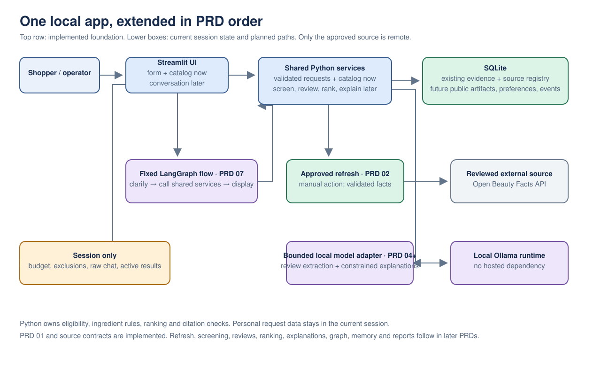
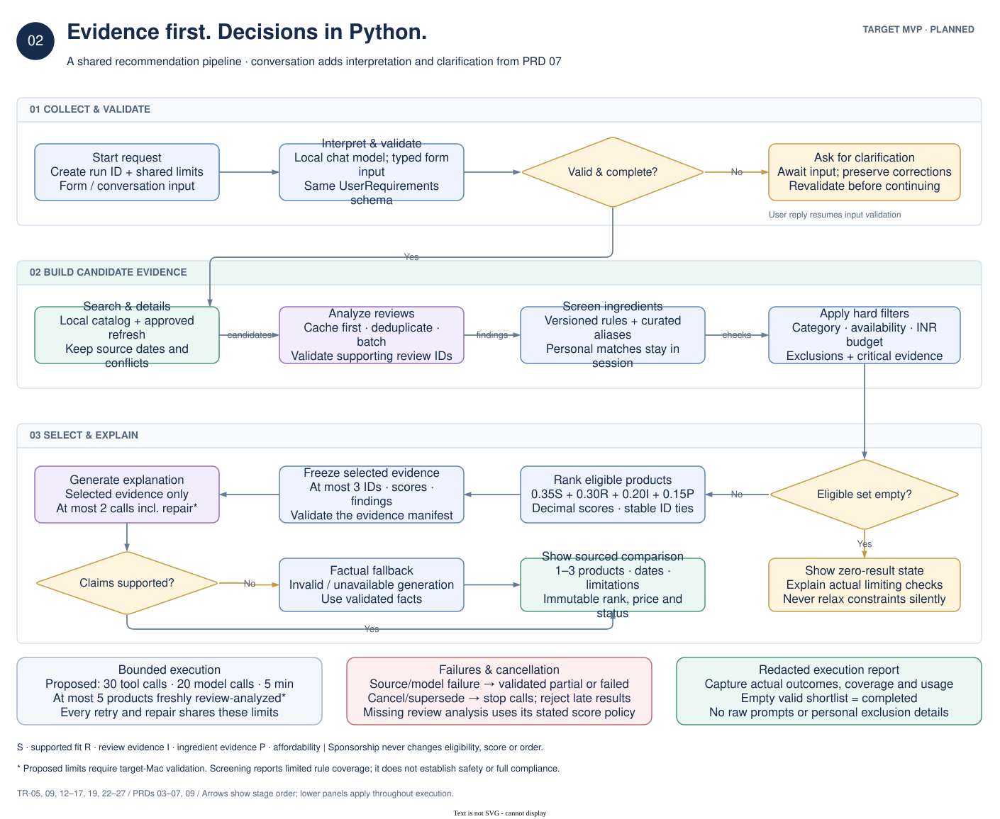
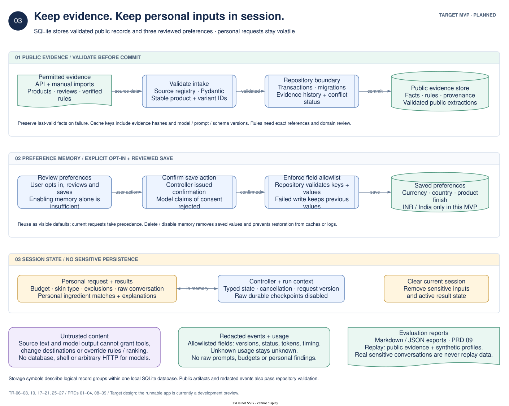

# Architecture

The [editable draw.io architecture diagram](cosmetic-advisor-architecture.drawio) describes the planned MVP from the [technical requirements](../requirements/TECHNICAL_REQUIREMENTS.md) and [nine PRDs](../requirements/README.md). The [PlantUML sequence diagrams](sequences.md) show the order of important interactions, with an editable text source for each path. All diagrams represent target design, not an already deployed application.

[ADR-0001](../adr/0001-local-modular-architecture.md) records the proposed architecture decision, alternatives, trade-offs, and revisit triggers. The [ADR index](../adr/README.md) tracks its status and future decisions.

## Diagram pages

The three views separate deployment, execution, and persistence so each can be read
without tracing unrelated connections. All pages describe planned capabilities;
the current runnable app is the development preview described in the [root guide](../../README.md).

### 01 — System architecture

The MacBook boundary contains one Python/Streamlit process, a separate local Ollama
runtime, and a local SQLite database. The form and conversational routes reuse the
same application services. Source and model adapters enforce integration boundaries;
repositories own persistent writes. The source API sits outside the device boundary.

### 02 — Recommendation flow

Read the numbered stages from top to bottom; the selection stage continues from right
to left. The controller creates the run context before any model interpretation.
Missing or ambiguous input pauses for clarification, then resumes validation. Hard
filters produce the eligible set before scoring; an empty set leads to an explicit
zero-result view. Selected facts remain fixed through generation, claim validation,
and factual fallback. The lower panels describe controls that apply across the run.

### 03 — Data and privacy

Separate paths show validated public evidence, reviewed preference saves, and volatile
personal state. Database symbols represent logical record groups in the same SQLite
database, not additional databases or services. Public extraction caches and redacted
events also pass repository validation; the overview omits their individual call arrows.

## How to read it

- Blue components implement application behavior and deterministic rules; purple identifies model-related boundaries; green identifies evidence and allowed persistent records; amber identifies personal session data, decisions, or unresolved outcomes. Red marks failure/cancellation controls. Labels and symbols carry meaning independently of color.
- Titled containers identify deployment boundaries or processing stages. Double-sided process symbols identify reusable adapters/workflows, cylinders identify storage, documents identify evidence/report artifacts, and diamonds identify decisions.
- Arrows represent invocation, stage order, or data exchange as labeled. Two-headed arrows show request/result or read/write exchange. Control and reporting panels apply across components; they are not separate background services. The diagrams omit routine return arrows and individual tool calls for readability.
- The form calls application services directly. The conversational path reaches the same services through LangGraph from PRD 07 onward.
- SQLite stores versioned product evidence, validated public-evidence artifacts, redacted events, and the three opted-in preferences. Avoid lists, raw conversation, current budgets, and personal matching details remain in session memory.
- Eligibility is evaluated before scores. The model explains validated evidence and cannot alter product selection, ranking, or ingredient-rule outcomes.
- A candidate with a confirmed exclusion, failed applicable rule, or unresolved critical evidence is withheld before ranking. Missing review analysis follows the documented missing-review policy; it does not count as favorable evidence. Claim validation checks actual support as well as citation identity.
- Hosted inference is an optional, disabled extension through the model adapter. Public hosting, a vector database, independent agents, and MCP serving are outside this diagram's MVP.

## Interaction sequences

The [PlantUML sequence-diagram guide](sequences.md) links five source files: catalog
refresh, review analysis, conversational recommendation, cancellation/supersession,
and preference save/reuse/deletion. The sequence pages complement the three overview
pages above; they do not add new runtime components or change product requirements.

## Requirements alignment

| View | Primary requirements | Architectural emphasis |
| --- | --- | --- |
| System | TR-01–05, 09–11, 17–23, 28 | Local deployment, direct form route, one graph from PRD 07, bounded integrations |
| Recommendation | TR-05, 09, 12–17, 19, 22–27 | Shared run limits, deterministic decisions, truthful empty/partial results, claim validation |
| Data and privacy | TR-06–08, 10, 17–21, 25–27 | Provenance, transactional writes, explicit preference confirmation, sensitive session state |

The redesign clarifies the existing architecture rather than introducing another
runtime or changing product policy. [ADR-0001](../adr/0001-local-modular-architecture.md)
remains **Proposed**. Numeric limits and scoring defaults retain their documented
proposed status; these diagrams are not implementation or benchmark evidence.

## Editing

Open `cosmetic-advisor-architecture.drawio` with a draw.io-compatible editor, including
the Draw.io Integration extension in VS Code or draw.io Desktop. The web editor at
[draw.io](https://app.diagrams.net/) also supports **File → Open from → Device**.
Its three pages contain native editable shapes, labels, containers, and connectors.

The `.drawio` file is the source of truth for the overview pages. The three
`.drawio.svg` files are readable page previews with each page's editable XML embedded.
After editing, regenerate affected previews with a white background, a 24 px border,
and embedded diagram data. These previews were rendered locally with draw.io.

The interaction sequences use `.puml` text files as their sources of truth. Open and
preview them using the [sequence-diagram guide](sequences.md#traceability-and-editing).

Check all pages visually for clipped text and connector collisions, then run
`make docs` (local links and editable diagram structure) and `make check` before
pushing. Structural validation does not replace the visual review.

Keep diagram changes aligned with the technical requirements and affected PRDs. The existing Mermaid overview in the technical requirements remains a compact text representation; the architecture and sequence sources provide fuller component and execution views.
