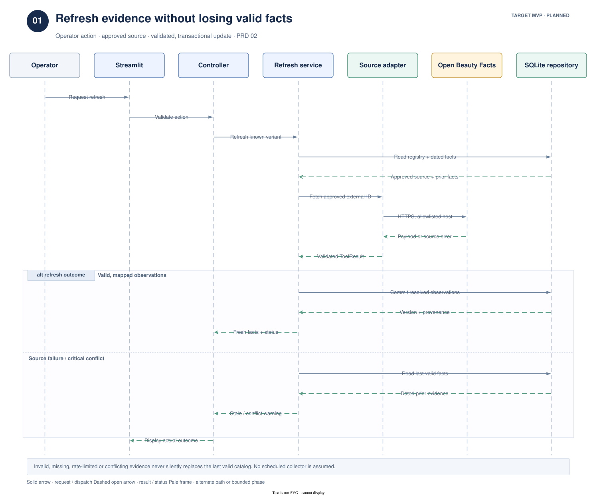
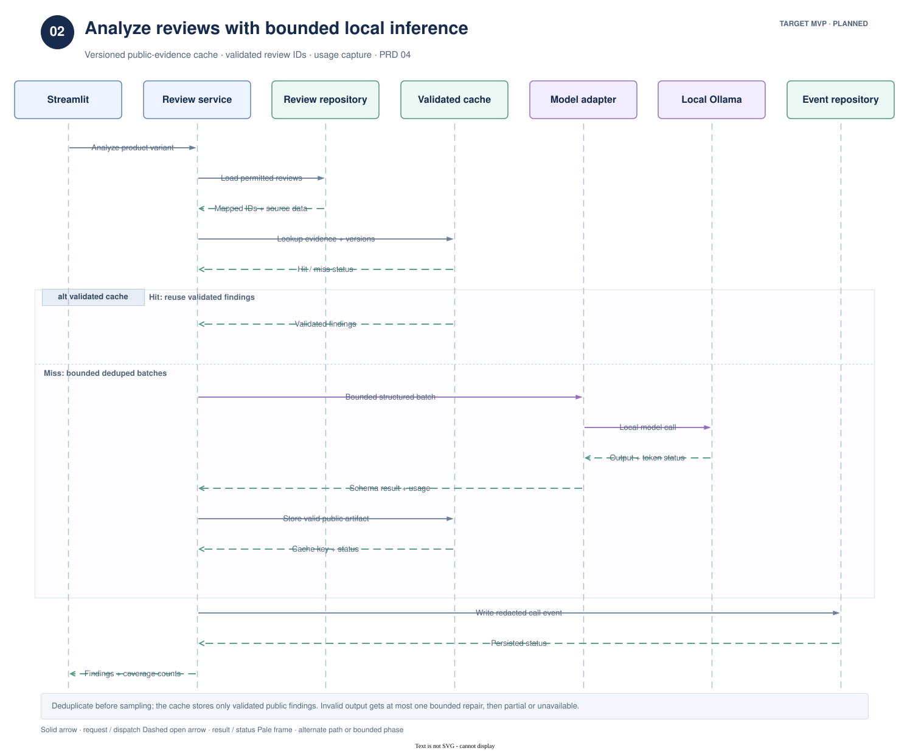
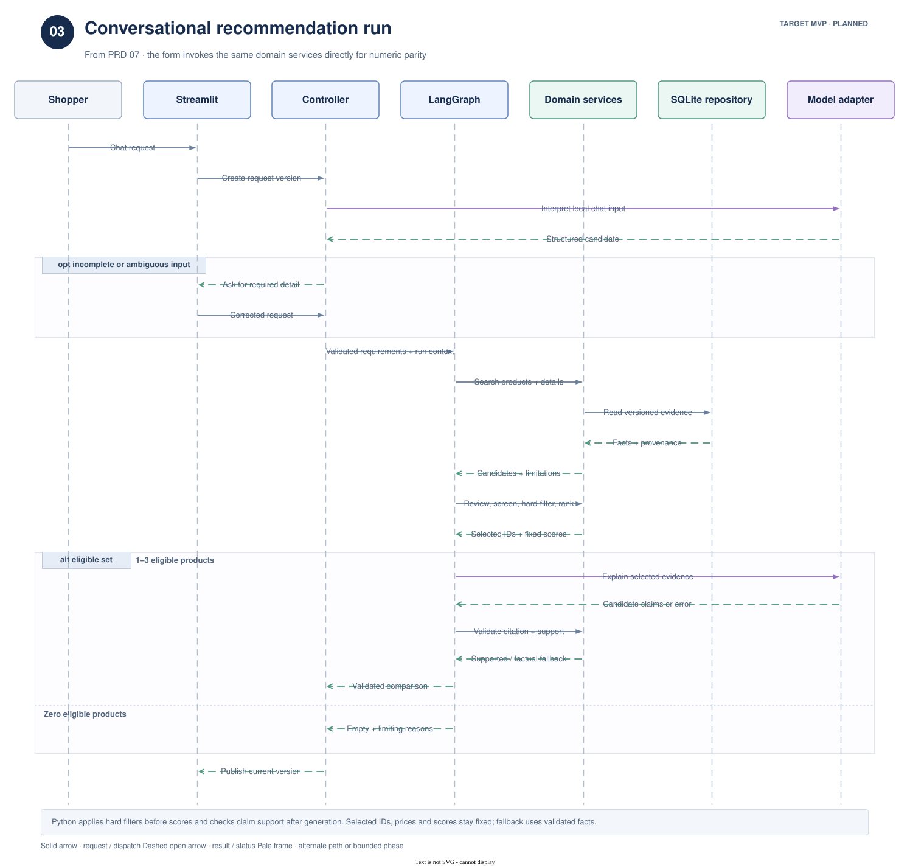
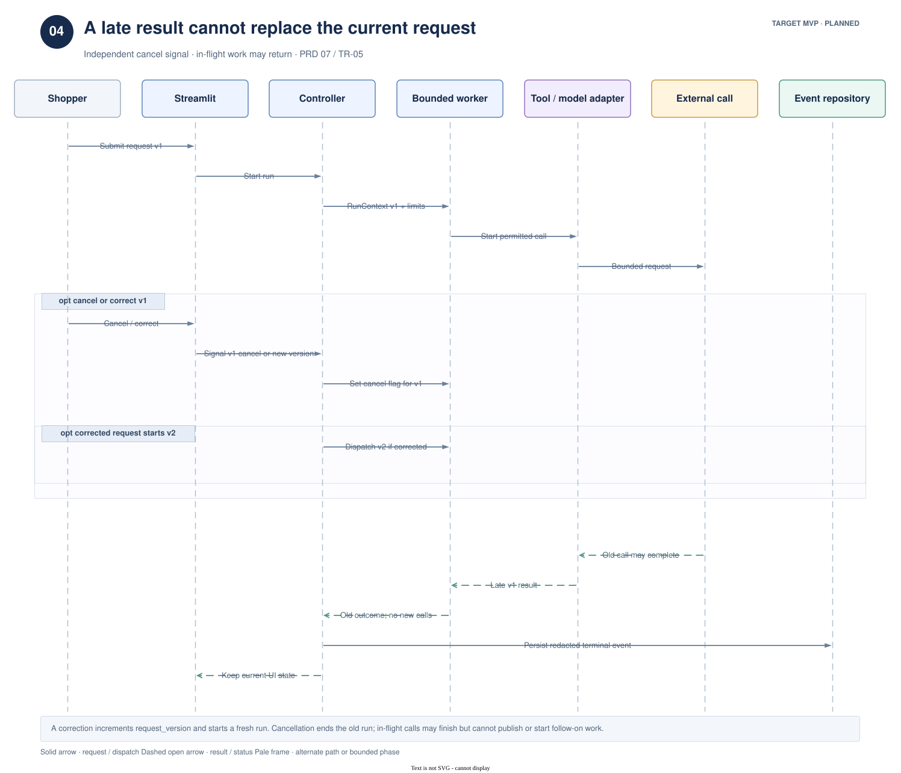
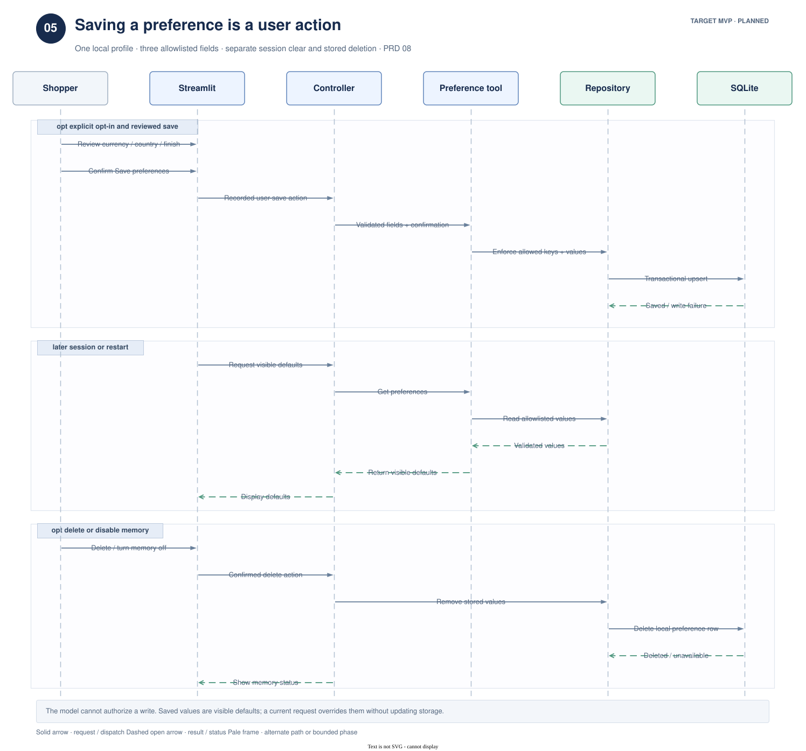

# Interaction sequences

These [five editable draw.io pages](cosmetic-advisor-sequences.drawio) show the
planned interaction order from the [technical requirements](../requirements/TECHNICAL_REQUIREMENTS.md)
and [PRDs 01–09](../requirements/README.md). They complement the
[system, recommendation, and data/privacy overviews](README.md). The current runnable
app remains a development preview; these pages do not claim implemented behavior.

Time runs downward. A solid arrow is a request or dispatch; a dashed open arrow is a
result or status. Pale `opt` frames mark optional work. `alt` frames split mutually
exclusive outcomes. Redacted events and a validated cache are logical repository
responsibilities within the same local SQLite boundary, not additional databases.

## 01 — Catalog refresh

The operator starts a known-variant refresh. The service reads the approved source
registry and dated local facts, then uses the allowlisted source adapter. Valid mapped
observations commit transactionally with provenance. On source failure or critical
conflict, the prior facts remain available with their actual dates and a warning.
The diagram covers the live Open Beauty Facts path; permitted manual imports use the
same validation and repository rules.

## 02 — Review analysis

The service loads permitted variant-mapped reviews, deduplicates before sampling,
and looks up a cache keyed by evidence and model/prompt/schema versions. A miss uses
bounded local model batches. Validated review IDs and coverage counts determine what
can be cached or shown. Each actual model attempt contributes a redacted usage event;
a cache hit does not invent a new call.

## 03 — Conversational recommendation

The controller creates a request version and run context before interpreting chat.
Missing input triggers clarification. The single graph calls shared services for
search, review analysis, ingredient checks, hard filters, and deterministic ranking.
Only selected evidence reaches explanation generation; Python checks citation identity
and claim support. An empty eligible set skips generation and returns the actual
limiting reasons. The structured form calls the same services directly and must
produce the same eligibility and numeric scores.

## 04 — Cancellation and supersession

A cancel action stops new calls for the old run. A corrected request also increases
`request_version` and may start a new run. An already started source/model call may
finish, but its old result cannot replace current UI state. Only a redacted terminal
event persists; raw graph checkpoints remain disabled.

## 05 — Preference memory

The shopper reviews the three allowed fields and explicitly saves them. The trusted
controller confirms that action; the preference tool and repository reject extra
fields and model-claimed consent. A later session reads validated defaults. Deleting
or disabling memory removes stored values. Clearing the current session is a
separate action that removes volatile personal input.

## Traceability and editing

| Page | Primary requirements |
| --- | --- |
| Catalog refresh | TR-07–08, 10–11, 20, 22–23; PRD 02 REF-01–08 |
| Review analysis | TR-14, 17, 19, 22, 25; PRD 04 REV-01–08 |
| Recommendation | TR-02, 04–05, 09, 12–17, 22–23; PRD 07 AGT-01–07 |
| Cancellation | TR-05, 19, 22–24; PRD 07 AGT-04–08 |
| Preference memory | TR-10, 18–19; PRD 08 MEM-01–07 |

Edit the native `.drawio` file and regenerate only affected `.drawio.svg` previews,
following the [architecture editing guide](README.md#editing). Check every page for
clipped text, connector collisions, and truthful `alt`/`opt` conditions before
running `make docs` and `make check`. The numeric limits shown in source documents
remain proposed until the corresponding release validates them.
