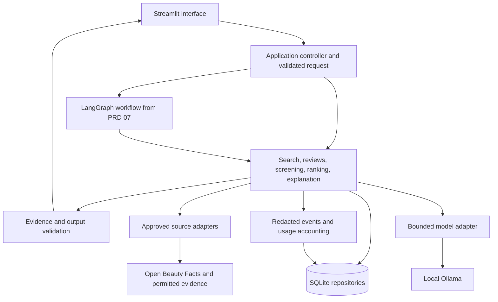

# AI Cosmetic Product Advisor — Technical Requirements

Status: Draft · Version: 1.0 · Prepared: 17 October 2026

Audience: engineers implementing and verifying the project. Product scope and release order are defined in the [PRD index](README.md). This document specifies the technical contracts shared by those releases; it is not an additional release or a user-story backlog. The repository includes a development scaffold; the PRD features remain implementation deliverables. See the [development guide](../development.md) for readiness and completion criteria.

[ADR-0001](../adr/0001-local-modular-architecture.md) explains the proposed architectural choices and alternatives. See the [ADR index](../adr/README.md) for decision status and history.

**Conformance:** “must” identifies a release requirement. Numerical defaults inherited from the PRDs remain proposed until validated on the target machine. New implementation choices identified as proposed must be recorded before the affected release ships. Changes to product behavior require updating the corresponding PRD as well as this document.

## 1. System boundary

**TR-01 — Supported deployment.** Build one local, single-user Streamlit application on macOS. Support sunscreen and moisturiser, India, INR, five supported skin types, and approximately 20–30 verified products in the completed MVP. The structured interface must work before the conversational workflow is introduced.

**TR-02 — Execution ownership.** One LangGraph orchestrator coordinates specialized Python functions. Python owns input validation, source selection, ingredient-rule evaluation, eligibility, arithmetic, citation validation, and persistence. Models interpret text, extract review findings, and phrase validated evidence. A model cannot override a deterministic decision.

Public hosting, authentication/accounts, multiple independent agents, vector databases, checkout, scheduled collectors, and MCP serving are outside this implementation. Optional hosted inference must not become a dependency of the local product.

## 2. Runtime and dependencies

| Area | Required baseline / responsibility |
| --- | --- |
| Python | Python 3.12, initially pinned to 3.12.15; see [ADR-0002](../adr/0002-python-and-development-tooling.md). Test other versions only if claiming support. |
| UI | Streamlit forms, catalog/detail views, comparisons, conversation, preferences, and execution reports |
| Validation | Pydantic schemas at input, import, tool, model-output, and configuration boundaries |
| Storage | SQLite through a repository layer; parameterized queries, transactions, explicit migrations |
| Local inference | Ollama adapter with structured-output validation and bounded calls; exact model selected against available RAM/processor |
| Orchestration | LangGraph for PRD 07 onward; earlier releases invoke the same application services directly |
| Retrieval | HTTPX for approved sources; BeautifulSoup only for an explicitly permitted HTML integration |
| Verification | Pytest for deterministic behavior and integration fixtures; separate live-source/local-model smoke checks |

**TR-03 — Reproducible dependencies.** Use `pyproject.toml` and `uv.lock` as the canonical dependency definition/resolution, with generated hashed `requirements*.txt` compatibility exports. Record adapters and transitive dependencies needed to reproduce each release. Validate official integration contracts before locking versions. Qwen3 4B remains a model candidate, not a required download.

## 3. Architecture and component boundaries

The [editable draw.io architecture diagram](../architecture/cosmetic-advisor-architecture.drawio) contains system, recommendation-flow, and data/privacy pages. The [PlantUML sequence diagrams](../architecture/sequences.md) show key interactions and alternate outcomes. See the [architecture guide](../architecture/README.md) and sequence guide for source links, legends, and scope.



**TR-04 — Separation of concerns.** Keep UI code, graph nodes, application services, source/model adapters, and repositories separate. Graph nodes call the same services as the structured path. Scoring and ingredient evaluation must be testable without Streamlit, a model, or network access. Models receive no database connection, shell capability, arbitrary HTTP client, or preference-write authority.

**TR-05 — Run lifecycle.** Assign each run a unique `run_id` and monotonically increasing session `request_version`. Use typed states: `awaiting_input`, `running`, `completed`, `partial`, `failed`, and `cancelled`; an empty valid shortlist is a completed result. Track the current stage and validated intermediate results. Sensitive graph state remains in memory; durable raw checkpoints are disabled.

The controller must support an independently signalled cancellation, using a bounded worker if needed to keep the UI responsive. A worker cannot publish results for a cancelled or superseded request. A running external/model call may finish after cancellation, but no new call starts and its result cannot replace current UI state.

## 4. Data and persistence requirements

**TR-06 — Types and identifiers.** Use stable identifiers for products/variants, sources, evidence observations, reviews, rule sets, analysis artifacts, runs, and calls. Store INR prices as integer paise; use decimal arithmetic for scores and USD cost accounting. Store timezone-aware UTC timestamps and show explicit dates/timezones in the interface. Unknown facts are null or an explicit unknown enum, never zero, false, or an empty string used as a substitute.

### Required logical records

| Record | Minimum fields and invariants |
| --- | --- |
| Product | Stable `product_id`, brand, name, category, variant/pack identity. Claims, availability, prices, ingredients, ratings, and sponsorship resolve through evidence rather than unsupported defaults. Distinct pack/formulation variants cannot silently share reviews or prices. |
| Source | `source_id`, type, approved host/endpoints or document reference, access/reuse conditions, attribution, date checked, enabled status. A source registry entry is required before collection/import. |
| Fact observation | `evidence_id`, product/source IDs, field and typed value, country/currency where relevant, original URL/document location, retrieval and verification times, content hash/version, validation/conflict status. An observation records what a specific source said. |
| Fact resolution | Selected evidence IDs and resolution-policy version for each canonical field; unresolved conflicts remain explicit. Ratings and review counts must come from a compatible source/variant snapshot. |
| Review | Stable review ID, mapped product/variant, source reference, permitted text/excerpt, collection date, optional rating/scale and explicitly supported skin-type metadata, normalized text hash. Strip unnecessary reviewer identifiers. |
| Ingredient rule | Canonical name, curated aliases, India scope, rule type, applicable category/use, concentration/other conditions and units, exact authoritative reference, version, last checked. Missing applicability information yields an unresolved check. |
| Analysis artifact | Evidence IDs/hashes, model identity, prompt/schema versions, sampling policy, validated extraction, coverage counts, confidence limitations. Persistent artifacts are independent of personal requests. |
| Run/call events | Run/call IDs, stage, product/artifact versions, status, times, retry/cache indicators, redacted error code, model identity, nullable token counts and provenance, estimated cost/rate version. No raw arguments, prompts, conversations, or personal exclusion findings. |
| Saved preferences | One local profile containing only preferred currency, purchase country, and product finish, plus necessary schema/save metadata. No budget, skin/allergy/medical history, avoid list, or conversation fields. |
| Budget ledger | If paid inference is enabled: per-call reservations, reconciled cost, rate version, and project/run totals. Active reservations count against available budget. |

**TR-07 — Integrity and updates.** Enforce foreign keys, unique identities/idempotency keys, enum/range checks, and transactional writes. Parse and validate an import before committing its accepted changes; reject invalid records with sanitized reasons. A failed import/refresh must not erase prior valid facts. Preserve evidence history and record explicit conflict resolution. Unknown identity/variant mappings require operator review.

**TR-08 — Versioning and recovery.** Maintain a schema version and repeatable forward migrations. Back up the valid database before migration, leave the previous database usable on failure, and document restoration. Product evidence, rules, scoring policy, prompts, schemas, and model identities must have versions sufficient to reproduce synthetic evaluation runs. Reproducing a real user's sensitive request is intentionally unsupported.

## 5. Internal contracts and integrations

**TR-09 — Shared schemas.** Define the following contracts before implementing their consumers:

| Contract | Required behavior |
| --- | --- |
| `UserRequirements` | Category enum, supported skin type, required non-negative budget, visible India/INR defaults, session-only exclusions, optional supported preferences; reject unsupported country/category and non-finite numeric values |
| `RunContext` | Run/request IDs, deadline/cancel signal, permitted tools, model/tool counters, and budget access; the trusted controller creates it and tools cannot relax it |
| `ToolResult[T]` | Typed payload, success/partial/unavailable/invalid status, evidence IDs, provenance/cache state, and sanitized error code; validate at every tool boundary |
| `IngredientResult` | Regulatory findings separate from personal matches; overall `eligible_within_checks`, `excluded`, or `requires_verification`; exact rule/evidence references |
| `ReviewAnalysis` | Validated aspects/sentiment, supporting review IDs, explicit skin-type evidence, collected/unique/analyzed/failed counts, confidence band and limitations |
| `RankingResult` | Ordered selected IDs, component/total scores, policy/evidence versions, session-only withholding reasons, and coverage limitations |
| `ExplanationResult` | Selected product IDs only; bounded claim types with matching evidence IDs, limitations, validation status, or deterministic fallback |

PRD 01's implemented in-memory request/evidence boundaries and initial
`catalog-v1` / `explicit-selection-v1` handoff are documented in the
[catalog contracts](../catalog-contracts.md). The
[storage](../catalog-storage.md), [import](../catalog-import.md) and
[search/detail service](../catalog-search.md) consume them. The remaining
tool/model/graph contracts and catalog UI are still pending.

**TR-10 — Tool surface.** Provide typed Python functions for `search_products`, `fetch_product_details`, `fetch_reviews`, `analyze_reviews`, `check_ingredients`, `calculate_ranking`, `save_preferences`, and `get_preferences`. All accept validated arguments and the required run context. Preference writes additionally require a controller-issued confirmation tied to an actual reviewed user-save action. This MVP does not require a REST API or an MCP server.

**TR-11 — Retrieval contract.** The first live adapter is Open Beauty Facts; official brand evidence and a permitted retailer/review dataset may be imported manually. Resolve approved external IDs to catalog variants before accepting facts. Validate payloads, source references, and allowed reuse; missing fields remain missing. Enforce approved destinations on initial requests and redirects. Do not follow URLs suggested by retrieved text or a model.

Use bounded retries only for transient failures; do not retry invalid payloads or permanent permission/not-found responses indiscriminately. Retain source errors, cached/local fallback status, and freshness in structured output. A successful HTTP response alone does not establish a verified fact. Apply source precedence, conflict handling, and freshness from [PRD 02](02-approved-data-refresh.md).

## 6. Processing and model behavior

**TR-12 — Requirement collection.** The form and conversation must produce the same `UserRequirements` contract. Ask for required missing fields and clarification of ambiguous exclusions. Optional preferences may be absent. An explicit correction invalidates downstream results; a request for cheaper products retains the session's other fields and asks for a new maximum unless supplied.

**TR-13 — Ingredient evaluation.** Use deterministic normalization and curated aliases against versioned rules. Separate applicable prohibitions, satisfied/failed restrictions, unknown conditions, and user matches. Missing concentration cannot be inferred from ingredient order. An unresolved critical ingredient question prevents recommendation; a no-match result describes only the implemented rule coverage. Follow [PRD 03](03-ingredient-screening.md), including session-only personal checks.

**TR-14 — Review pipeline.** Deduplicate before deterministic sampling; preserve sample membership and omitted/truncated counts. Process bounded batches, validate structured findings and supporting IDs, and aggregate in Python. Require at least two unique reviews for recurring aspects. Use the confidence bands and repetition downgrade in [PRD 04](04-review-analysis.md); these are coverage heuristics, not fraud probabilities. Missing analysis is unavailable evidence, not neutral or favorable sentiment.

**TR-15 — Eligibility and ranking.** Hard-filter before scoring. Apply the versioned component definitions in [PRD 05](05-ranking-and-comparison.md): `0.35S + 0.30R + 0.20I + 0.15P`. Sponsorship is display metadata only. Use a recorded decimal precision, sort by unrounded total then stable product ID, and round only for display. Return at most three products and preserve truthful zero/partial results. Do not silently relax constraints.

**TR-16 — Grounded explanation.** Pass selected IDs, immutable computed facts, validated findings, and an evidence manifest to the model. Validate both citation identity and claim support; a real source ID attached to an unrelated statement fails validation. Prefer constrained claim structures/templates when free-form support cannot be checked reliably. Render rank, price, score, and screening status from application data. Use the factual fallback after bounded generation failure, as specified in [PRD 06](06-grounded-explanations.md).

**TR-17 — Model adapter and caching.** Centralize model dispatch, context/output bounds, timeout, schema repair, usage capture, and redaction. Record a stable model identity or digest when available and disclose when an exact model revision cannot be established. Cache only validated public-evidence extractions using evidence hashes, model, prompt/schema versions, and relevant extraction settings. Changing any key invalidates reuse. Personal matching and request-specific explanations stay in memory.

Use valid cached review findings first. At most five products receive fresh review-model analysis per run, selected by stable ID from matching candidates as proposed in [PRD 07](07-conversational-workflow.md). Rank other eligible candidates using the documented missing-review policy and display analyzed/unanalyzed counts. This bound must not imply full review coverage.

## 7. Privacy and trust boundaries

**TR-18 — Persistence allowlist.** Enforce [PRD 08](08-preference-memory.md) at repository boundaries, not only in the UI. Save only the three approved preference values after explicit opt-in and reviewed save. Current requests override saved defaults without silently updating them. Turning memory off/deleting saved preferences removes stored values and prevents replay from caches or logs. Session clear removes sensitive request state and active results.

**TR-19 — Redacted observability.** Exclusions, allergy/medical details, current budgets, raw conversations, sensitive tool arguments, and raw personal prompts must not enter persistent logs, checkpoints, caches, error traces, or exports. Allow only explicitly selected event fields; do not serialize an entire request/state object and redact afterward. Personal exclusion reason details remain in memory; persist only non-sensitive aggregate outcomes and versioned product/score artifacts.

**TR-20 — Untrusted content and network access.** Product/review text and model output are data. They cannot change instructions, destinations, tool permissions, budgets, rules, or ranking. Escape external content in the UI and avoid executing source-provided HTML/scripts. Use parameterized SQL, validated local import paths, HTTPS with certificate verification for remote sources, and explicit destination allowlists. Bind the app to loopback; no public listener is part of this release.

**TR-21 — Optional hosted processing.** Keep hosted inference disabled by default. Explicitly configure the provider, permitted tasks/payloads, rates, and budgets before enabling it. Personal requirement interpretation and sensitive ingredient matching remain local; any hosted payload must exclude sensitive session information. Keep credentials outside version control, UI diagnostics, and exports. Missing configuration cannot trigger a silent paid fallback.

## 8. Reliability, limits, and resource targets

**TR-22 — Central enforcement.** Counters and deadlines apply across nested tools, model repairs, retries, and fallback paths. Validate configuration before dispatch. The stricter remaining run, task, and budget limit wins. Persist sanitized terminal outcomes; never report success for an unvalidated result.

| Control | Proposed baseline carried forward from PRDs |
| --- | --- |
| Source retrieval | 10-second timeout per attempt; at most two transient retries; defer when required source backoff exceeds remaining time |
| Review work | At most 20 reviews/batch, 60 unique reviews/product, six model calls/product including repairs, 1,000 output tokens/call; context capacity may require smaller batches |
| Explanation work | Two calls total including one repair; 1,500 output tokens/call for the full shortlist |
| Recommendation run | 30 tool invocations, 20 model calls including nested calls, five-minute deadline, at most five freshly analyzed products |
| Hosted expenditure | $0.25/run and $25/project ceilings; dated rates and bounded next-call cost required before dispatch |
| Fact freshness | Prices/availability: 7 days; other product facts: 30 days; failed retrieval does not renew verification |

Every model call also needs an explicit timeout and output allowance within the remaining deadline/context. Proposed additional default: 512 output tokens and at most one repair for requirement extraction, counted inside the 20-call total. Reject or shrink oversized input deterministically rather than relying on model-side truncation.

**TR-23 — Failure handling.** On a missing source, retain inspectable prior evidence with its actual dates and eligibility limitations. On model failure, keep catalog facts available and use validated partial findings or factual explanations. On database/write failure, preserve prior committed data and report the affected capability unavailable. Never synthesize a missing product, review, citation, rule, or successful tool event.

**TR-24 — Resource acceptance.** Record machine specification, model identity, dataset, and cache state with performance results. Proposed target: p95 under two seconds for 20 warm catalog searches over 30 products without model/network calls. Validate the five-minute run ceiling independently of model quality: exhaustion ends in a truthful partial/failure state. Long work must expose progress and a usable cancel control. No fixed RAM minimum or inference-latency claim is approved before hardware benchmarking.

## 9. Usage accounting and export

**TR-25 — Usage accuracy.** Capture every model attempt from PRD 04 onward, distinguishing measured, estimated, and unknown tokens. Unknown values remain null and make totals explicitly partial; cache hits do not create fictitious model usage. Report local API expenditure as $0 while device/electricity cost remains unmeasured. Aggregate durations with clear wall-clock versus summed-call labels.

**TR-26 — Paid-call accounting.** When enabled, estimate USD cost using dated input/output rates per million tokens. Atomically reserve worst-case input plus permitted output cost before dispatch; active reservations and settled spend count against both ceilings. Reconcile measured usage afterward. Unknown rates or unbounded input deny dispatch. A cancelled call may still incur charges; retain its reservation until actual usage or a defensible upper bound is settled.

**TR-27 — Evaluation export.** Export Markdown or JSON with run/product IDs, non-sensitive versioned artifacts, sanitized validation outcomes, coverage, usage provenance, and limitations. Use frozen permitted public evidence and separately labeled synthetic profiles for replay. Record A/B raw-review versus batched-summary/cache results, including cold/warm state and summary-creation overhead. Report observed token reduction honestly; use [PRD 09](09-usage-and-evaluation.md) for its proposed 20% target and final demonstration requirements.

## 10. Configuration, packaging, and operation

**TR-28 — Configuration.** Use validated configuration for database/data paths, local model endpoint/name, approved sources, freshness, policy versions, inference bounds, and optional provider budgets/rates. Suggested environment prefix: `ADVISOR_`. Reject invalid or contradictory limits at startup. Provide an example configuration without credentials; export only an explicit non-secret subset. Display capability health separately so missing Ollama does not disable the catalog.

Proposed implementation layout; paths below are deliverables, not existing code:

```text
app.py                         Streamlit entry point
agents/                        Typed state, graph, and node adapters
schemas/                       Request, evidence, tool, model, and configuration contracts
services/                      Validation, analysis, screening, ranking, usage, explanation
tools/                         Allowlisted source and preference tool adapters
repositories/                  SQLite queries and transaction boundaries
database/migrations/           Versioned database changes
data/                          Permitted seed/import examples and versioned rule data
prompts/                       Versioned extraction and explanation templates
tests/                         Unit, integration, and labeled evaluation fixtures
requirements.txt               Pinned runtime dependencies
requirements-dev.txt           Pinned verification dependencies
.env.example                   Non-secret configuration example
```

**TR-29 — Runnable release.** Each increment must include its UI, valid schemas/migrations, permitted seed data, pinned dependencies, and operating instructions. Document environment creation, imports/bootstrap, local model health checks when needed, and the local launch command `streamlit run app.py --server.address 127.0.0.1`. These become runnable after implementation; they are not setup performed by this document.

Keep generated databases, caches, credentials, local configuration, model files, and execution exports out of version control. Document dataset attribution, backup/restore, refresh/model/database failure recovery, session/preference clearing, and how to rerun the release checks. No cloud infrastructure is required.

## 11. Verification and release traceability

**TR-30 — Verification strategy.** Use unit tests for deterministic validation, matching, arithmetic, and policy boundaries; integration tests for transactional imports, migrations, tool contracts, cache invalidation, cancellation, and redaction; and full application checks for each deployable increment. Use recorded responses for repeatable failure tests and distinguish them from live-source checks. Do not require byte-identical LLM prose; require valid schemas, supported claims, and unchanged deterministic decisions.

| Release | Primary technical requirements | Required evidence |
| --- | --- | --- |
| [01](01-catalog-and-search.md) | TR-01, 03–04, 06–09, 12, 28–30 | Clean local launch; catalog persists; boundary/invalid/empty searches; field-level provenance |
| [02](02-approved-data-refresh.md) | TR-07–08, 10–11, 20, 22–23 | Actual lookups for five products; repeatable timeout/conflict/idempotency tests; last-valid facts preserved |
| [03](03-ingredient-screening.md) | TR-06, 09, 13, 19 | Alias/rule fixtures; unknown concentration/missing declaration; sourced findings; no sensitive persistence |
| [04](04-review-analysis.md) | TR-03, 09, 14, 17, 19, 22, 25 | Local model smoke check; review-ID support; count reconciliation; injection/invalid output; cache and usage checks |
| [05](05-ranking-and-comparison.md) | TR-06, 09, 15 | Fixed score vectors; hard exclusions; ties/zero budget; sponsorship neutrality; identical numeric results |
| [06](06-grounded-explanations.md) | TR-09, 16–17, 20, 23 | Matching claim citations; immutable selected facts; unrelated/fabricated citations rejected; factual fallback |
| [07](07-conversational-workflow.md) | TR-02, 04–05, 10, 12, 17, 22–24 | Structured/conversational parity; actual tool traces; limits, stale-result suppression, cancellation |
| [08](08-preference-memory.md) | TR-10, 18–19 | Three allowed values reused across restart; unauthorized writes rejected; deletion and persistent-store inspection |
| [09](09-usage-and-evaluation.md) | TR-21, 25–27, 29–30 | Usage reconciliation; optional budget preflight; redacted replay export; five successful scenarios, two edge cases, A/B report |

Controls apply when their capability first ships, even when a later release adds its report/UI. Rerun affected earlier checks after changing shared contracts. The final release must meet 100% tested hard-constraint compliance and evidence traceability, with zero unsupported safety assurances; these are acceptance targets, not measured results.

## 12. Decisions required during implementation

| Decision | Owner and deadline |
| --- | --- |
| Target MacBook, baseline Python, pinned packages, model/context capacity | Engineering; runtime pins before PRD 01, model benchmark before PRD 04 |
| Exact approved-source API contract, access/reuse terms, and variant mappings | Engineering/data; before enabling the PRD 02 adapter/import |
| Authoritative rule references, applicability, dataset coverage and version | Data/domain reviewer; before PRD 03 uses real regulatory findings |
| Freshness, scoring, confidence, and resource defaults | Product/data/engineering; record policy versions before the affected release ships |
| Claim vocabulary and evidence-support validation | Engineering/product; before PRD 06 enables generated explanations |
| Optional hosted provider/task policy, dated rates, token bounds | Engineering/product; before any paid dispatch is enabled |

Unresolved inputs do not authorize fabricated data, unsupported compatibility claims, a broader market, persistent sensitive memory, or an automatic paid fallback.
